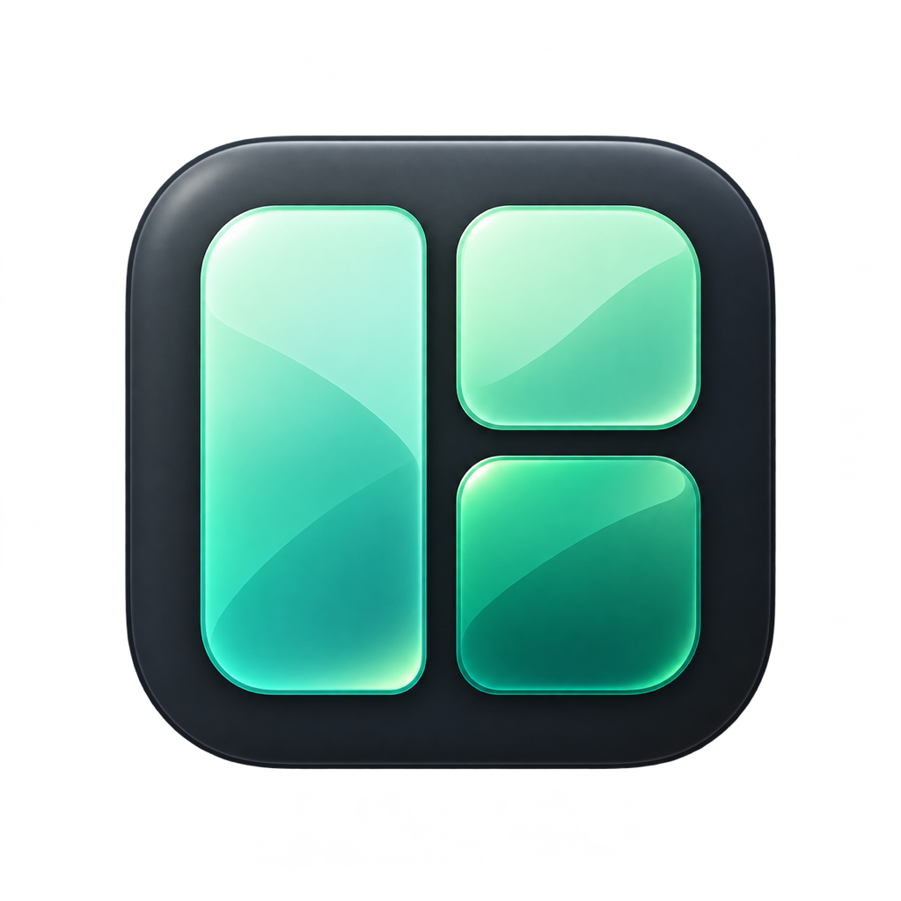

<p align="center">
  
</p>

# Yabai Studio

Uma interface nativa para macOS que facilita a instalação e a configuração do **yabai** e do **skhd**. Configure o mosaico de janelas, ajuste margens e espaçamento, crie regras por aplicativo e consulte os atalhos em uma interface em português.

O Studio é um projeto independente. A organização das janelas é feita pelo [yabai](https://github.com/asmvik/yabai); os atalhos globais são executados pelo [skhd](https://github.com/asmvik/skhd).

## O que ele faz

- Instala o yabai a partir do pacote oficial, verificando o hash publicado e a assinatura do executável.
- Instala o skhd incluído no app, sem exigir Homebrew no computador de quem vai usar.
- Mostra uma prévia ilustrativa dos modos mosaico, pilha e livre.
- Ajusta margens, espaço entre janelas, proporção da divisão e comportamento do mouse.
- Define aplicativos como flutuantes ou organizados e salva perfis de configuração.
- Ativa e desativa os atalhos globais e seu início no login.
- Orienta a liberação de Acessibilidade, a configuração dos atalhos nativos de Mesas e a redução de movimento do macOS.
- Adapta a interface ao tamanho da janela, inclusive quando ela é encaixada pelo próprio yabai.

## Instalar e começar

Se houver um `.dmg` disponível nas Releases do repositório:

1. Abra o `.dmg` e arraste **Yabai Studio** para **Applications / Aplicativos**.
2. Abra o app pela pasta Aplicativos.
3. Em **Conexão**, clique em **Instalar yabai** e siga as instruções para permitir Acessibilidade.
4. Em **Atalhos**, clique em **Instalar skhd → Salvar e ativar atalhos**. O skhd precisa de sua própria permissão de Acessibilidade.
5. Volte ao Studio e clique em **Já autorizei**.
6. Ajuste as preferências em **Organização** e clique em **Salvar e aplicar**.

Os builds locais são assinados ad hoc, sem notarização da Apple. As permissões do macOS precisam ser concedidas pelo usuário. O Studio não altera o SIP.

## Configuração de referência

O ponto de partida é inspirado no tutorial do **Josean Martinez**:

[How To Setup And Use The Yabai Tiling Window Manager On Mac](https://www.josean.com/posts/yabai-setup)

Inclui mosaico (`bsp`), margens e espaçamento de 12 px, novas janelas à direita ou abaixo, cursor acompanhando o foco e Option para mover ou redimensionar. System Settings, Calculator e Karabiner-Elements começam como exceções flutuantes.

Configurações já salvas são preservadas. O botão **Usar padrão recomendado** carrega esses valores para revisão e aplicação.

### Principais atalhos

| Teclas | Ação |
| --- | --- |
| Shift + Option + 1–7 | Enviar a janela em foco para uma Mesa existente |
| Option + H / J / K / L | Focar janela à esquerda / abaixo / acima / direita |
| Shift + Option + H / J / K / L | Trocar de posição com a janela vizinha |
| Control + Option + H / J / K / L | Reposicionar a janela no mosaico |
| Option + S / G | Focar monitor esquerdo / direito |
| Shift + Option + S / G | Enviar a janela para outro monitor |
| Shift + Option + T | Alternar janela flutuante |
| Shift + Option + M / E | Maximizar no mosaico / equilibrar |

Para **mudar diretamente para uma Mesa**, configure **Control + número** em Ajustes do Sistema → Teclado → Atalhos de Teclado → Mission Control. As Mesas precisam existir para que as opções apareçam.

O serviço do Studio também mantém os atalhos Control + Option + 1–7. Eles tentam o comando do yabai e, se necessário, recorrem a Control + setas; esse caminho pode passar por Mesas intermediárias. A interface recomenda os atalhos nativos diretos para evitar esse percurso. **Reduzir movimento** pode suavizar a transição, mas não elimina todas as animações.

## Compilar a partir do código

Requisitos: macOS, Xcode Command Line Tools e um SDK com SwiftUI. O script compila para a arquitetura do Mac atual, com deployment target macOS 14. O desenvolvimento e os testes de execução foram feitos em Apple Silicon com macOS 27; outras versões e arquiteturas ainda precisam de validação de execução.

```sh
xcode-select --install  # se as ferramentas ainda não estiverem instaladas
sh scripts/build.sh
```

O app é criado em `build/Yabai Studio.app`. O script compila o skhd a partir da fonte incluída e assina os executáveis localmente.

Para gerar o instalador com o atalho para Aplicativos:

```sh
sh scripts/build.sh --dmg
```

Saída: `dist/Yabai Studio.dmg`.

### Testes

```sh
sh scripts/test.sh
```

Os testes cobrem a geração dos atalhos, argumentos com espaços e aspas, confirmação da mudança de Mesa, destino inexistente e falha da navegação nativa. Eles usam respostas simuladas e não movimentam suas janelas. A validação de atalhos reais depende das permissões e das configurações do macOS.

## Dados e serviços

Os dados ficam em `~/Library/Application Support/YabaiStudio/`:

- `settings.json`: preferências, perfis e regras.
- `startup.sh`: ajustes carregados pelo yabai na inicialização, sem o Studio aberto.
- `Engine/`: executáveis instalados pelo Studio.
- `skhdrc`: configuração de atalhos gerenciada pelo Studio.
- `skhdrc.backup`: cópia anterior ao reaplicar os atalhos.
- `skhd.log`, `hotkey-actions.log` e arquivos de erro: diagnóstico local.

O início no login usa `~/Library/LaunchAgents/local.yabai.studio.skhd.plist`. **Desativar** na aba Atalhos para esse serviço e remove seu início no login. Outro skhd em execução é detectado antes da ativação; arquivos externos como `~/.skhdrc` não são sobrescritos.

Os registros não capturam o texto digitado. Eles contêm saídas e erros dos comandos acionados pelos atalhos.

## Limitações atuais

- **Salvar e aplicar** mantém os ajustes após reiniciar o Mac: grava um script próprio, adiciona um bloco ao final do `yabairc` usado pelo serviço e habilita o yabai no login. A configuração anterior recebe um backup. **Aplicar só agora** faz uma alteração temporária. Configurações com saídas antecipadas (`exit`, `exec`, `return`) ou interpretadores não compatíveis exigem integração manual via Exportar.
- O app não cria Mesas nem altera os atalhos nativos do macOS automaticamente.
- O tamanho mínimo imposto por um aplicativo pode impedir encaixes pequenos. O Studio não força esse limite nem torna janelas flutuantes automaticamente.
- A prévia é ilustrativa; não representa a árvore real de janelas.
- Algumas ações dependem da versão do yabai, das permissões, do layout e da existência de janelas vizinhas.
- A configuração recomendada do skhd é restaurada ao reaplicar os atalhos; preserve edições manuais antes dessa ação.

## Estrutura

```text
Sources/             Interface SwiftUI e integração com os serviços
Resources/           Metadados do app
Assets/              Ícone do aplicativo
ThirdParty/skhd/     Fonte original do skhd 0.3.9 e licença
Tests/               Testes sem movimentação de janelas reais
scripts/             Compilação, empacotamento e testes
```

## Créditos e referências

- **[yabai — Åsmund Vikane](https://github.com/asmvik/yabai):** o gerenciador de janelas que realiza a organização. Consulte a [documentação oficial](https://github.com/asmvik/yabai/wiki).
- **[skhd — Åsmund Vikane](https://github.com/asmvik/skhd):** o serviço que captura os atalhos globais. A versão 0.3.9 incluída é compilada sem modificações; a fonte e a licença MIT estão em `ThirdParty/skhd/`.
- **[Josean Martinez — tutorial de configuração do yabai](https://www.josean.com/posts/yabai-setup):** referência para os padrões e para os atalhos recomendados.
- **Apple:** orientações sobre [várias Mesas](https://support.apple.com/pt-br/guide/mac-help/mh14112/mac) e [redução de movimento](https://support.apple.com/pt-br/guide/mac-help/mchlc03f57a1/mac).

O ícone do Studio foi criado com geração de imagens por IA. O projeto não é afiliado aos autores das referências acima.

## Licença

O código do Studio é distribuído sob a [licença MIT](LICENSE). O skhd mantém sua [licença MIT original](ThirdParty/skhd/LICENSE.txt).


### Recuperação do skhd após o login (0.7.1)

O serviço mantém `RunAtLoad` ativo e volta a iniciar após uma saída por falha, com intervalo mínimo de 10 segundos. Isso cobre o encerramento do skhd quando a Entrada Segura do Teclado está temporariamente ativa durante o login. O Studio não desativa essa proteção: aguarda sua liberação pelo macOS.

Após atualizar o Studio, clique uma vez em **Salvar e reaplicar atalhos** para instalar a nova política do serviço. O botão descarrega a definição anterior e a registra novamente; reiniciar somente o processo não atualiza a política de recuperação.

Permissões de Acessibilidade continuam necessárias. Desativar os atalhos descarrega o serviço e remove seu arquivo de início no login, impedindo que ele volte a iniciar automaticamente.
